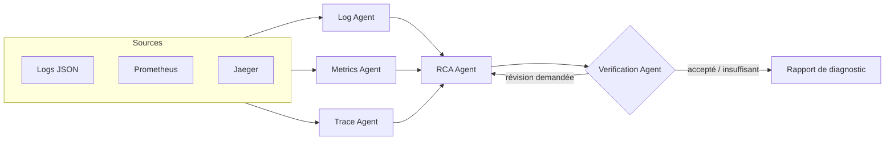

# doctor_log

[](https://github.com/mariem-rabeh/doctor_log/actions/workflows/ci.yml)


**Diagnostic automatique d'incidents de production par un système multi-agents.**
doctor_log croise les **logs**, les **métriques** et les **traces** d'une application,
propose une cause racine, la **vérifie**, et produit un rapport où chaque affirmation
renvoie à une preuve identifiée.

> **Principe fondateur : les chiffres viennent des outils Python, jamais du LLM.**
> Le LLM interprète des preuves déjà calculées ; il ne peut citer que des identifiants
> de preuves existants (`log-001`, `met-003`, `trc-002`…), sinon sa réponse est rejetée.

---

## Sommaire

- [Fonctionnalités](#fonctionnalités)
- [Architecture](#architecture)
- [Démarrage rapide (Docker)](#démarrage-rapide-docker)
- [Démonstration : incident en direct](#démonstration--incident-en-direct)
- [Développement local](#développement-local)
- [Tests et évaluation](#tests-et-évaluation)
- [Structure du dépôt](#structure-du-dépôt)
- [Stack technique](#stack-technique)

---

## Fonctionnalités

- **Trois agents d'analyse en parallèle** : logs, métriques (détection du point de rupture)
  et traces (temps propre par opération, origine des erreurs).
- **Agent RCA** : classe les hypothèses de cause racine, chacune appuyée par des preuves citées.
- **RAG sur des runbooks** (`knowledge/`) : le RCA reçoit les procédures les plus proches
  de l'incident (recherche BM25). Ce sont des connaissances, jamais des preuves : elles
  ne comptent pas dans la confiance.
- **Agent de vérification** : contrôles déterministes (existence des preuves, fenêtre
  temporelle, valeurs réellement présentes dans les données, contradictions entre sources)
  puis jugement *causalité vs corrélation* ; la **confiance est calculée en Python**.
- **Boucle de révision** (2 itérations max) et conclusion prudente :
  `confirmed`, `probable` ou `insufficient_evidence`.
- **Deux modes de source** : jeux de données reproductibles ou **télémétrie live**
  (fichiers de logs, Prometheus, Jaeger).
- **Interface web** : création d'investigations, suivi en temps réel, rapport détaillé.
- **Fournisseurs LLM interchangeables** : Gemini, Groq, ou `fake` pour travailler sans réseau.

## Architecture



| Couche | Rôle |
|---|---|
| `backend/app/tools` | Lecture des sources et calculs (percentiles, ruptures, self-time) — **déterministe** |
| `backend/app/agents` | Agents LangGraph : interprétation LLM ancrée sur les preuves |
| `backend/app/graph` | Orchestration du workflow et construction du rapport |
| `backend/app/api` | API REST FastAPI (incidents, analyse, statut, rapport) |
| `frontend` | Interface React / TypeScript / Tailwind |
| `demo-app` | Microservices instrumentés (OpenTelemetry) pour provoquer de vrais incidents |

## Démarrage rapide (Docker)

Prérequis : Docker Desktop et une clé API [Gemini](https://aistudio.google.com/api-keys)
ou [Groq](https://console.groq.com/keys).

```bash
cp .env.example .env          # puis renseigner LLM_PROVIDER et LLM_API_KEY
docker compose up -d --build
```

| Service | URL |
|---|---|
| Interface web | http://localhost:8080 |
| API (Swagger) | http://localhost:8000/docs |
| Jaeger | http://localhost:16686 |
| Prometheus | http://localhost:9090 |
| Demo-app | http://localhost:8001 |

Arrêt : `docker compose down` (ajouter `-v` pour effacer la base et les logs).

> La clé API ne doit figurer **que** dans `.env`, qui n'est pas versionné.

## Démonstration : incident en direct

1. Démarrer la stack (`docker compose up -d --build`).
2. Provoquer un incident sur la demo-app :

   ```bash
   python scripts/trigger_incident.py s01   # s01 pool DB saturé · s02 CPU · s03 requête lente · s04 dépendance en panne
   ```

3. Dans l'interface, **Nouvelle investigation** → source **Live** → fenêtre couvrant l'incident.
4. Suivre l'avancement des agents, puis consulter le rapport : cause probable, confiance,
   hypothèses, preuves citées et actions de vérification.

Le déroulé complet de la démo, avec un plan B en cas de problème, est dans [`docs/DEMO.md`](docs/DEMO.md).

## Développement local

```bash
docker compose -f docker-compose.dev.yml up -d   # PostgreSQL, Prometheus, Jaeger

cd backend
python -m venv .venv
.venv\Scripts\activate            # Linux/macOS : source .venv/bin/activate
pip install -e ".[dev]"
alembic upgrade head
uvicorn app.main:app --reload     # http://localhost:8000/health

cd ../frontend
npm install && npm run dev
```

Analyse en ligne de commande, sans serveur :

```bash
cd backend
python -m app.cli run ../datasets/db-pool-exhaustion          # avec le LLM configuré
python -m app.cli run ../datasets/db-pool-exhaustion --fake   # sans LLM
```

Après une modification de `backend/app/db/models.py` :
`alembic revision --autogenerate -m "description"`, relire le fichier généré, puis `alembic upgrade head`.

## Tests et évaluation

```bash
cd backend
pytest                                   # tests unitaires et d'intégration
E2E=1 pytest tests/e2e                   # bout en bout, stack Docker démarrée
```

Les tests de base de données utilisent `DATABASE_URL` et sont ignorés si PostgreSQL
n'est pas joignable. La CI GitHub Actions exécute lint, typage et tests à chaque push.

**Évaluation de la qualité du diagnostic** sur six scénarios, dont deux pièges
(logs trompeurs, métriques manquantes) où la bonne réponse est de rester prudent :

```bash
python -m eval.run_eval --runs 1 --pause 45
```

Les résultats (précision de la cause, cohérence, ancrage des preuves, latence) sont
publiés dans [`backend/eval/results.md`](backend/eval/results.md).

Les jeux de données sont générés de façon reproductible :
`python scripts/generate_dataset.py` (`--check` pour les valider).

## Structure du dépôt

```
backend/          API FastAPI, agents, workflow LangGraph, outils, tests, évaluation
frontend/         Interface React + TypeScript + Tailwind (servie par Nginx en Docker)
demo-app/         orders-service et payment-service instrumentés (OTel, Prometheus)
datasets/         Six scénarios d'incident avec diagnostic attendu
knowledge/        Runbooks de la base de connaissances (RAG)
infrastructure/   Configuration Prometheus
scripts/          Génération des datasets, déclenchement d'incidents
```

## Stack technique

Python 3.11+ · FastAPI · LangGraph · Pydantic v2 · SQLAlchemy / Alembic · PostgreSQL ·
React · TypeScript · Tailwind · Prometheus · OpenTelemetry · Jaeger · Docker Compose ·
GitHub Actions

## Auteurs

Projet réalisé par **Mariam Rabah** et **Ichrak**.
